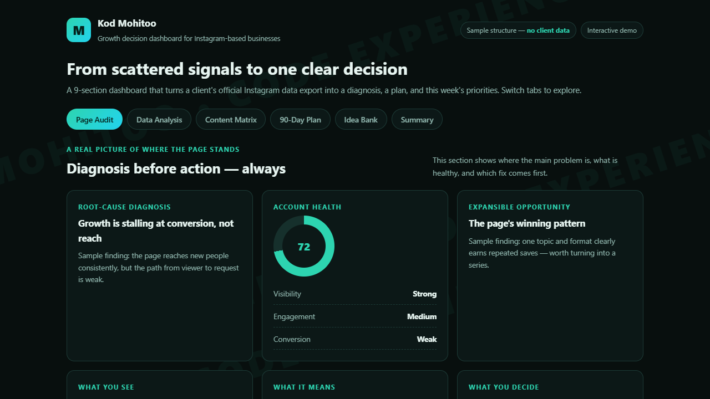
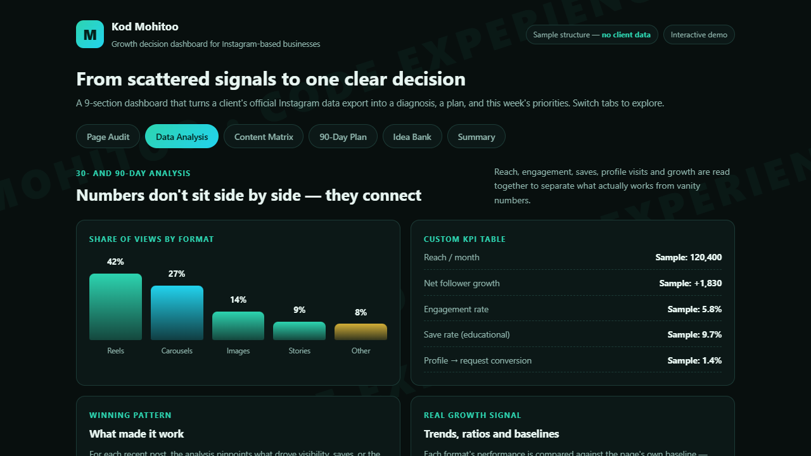
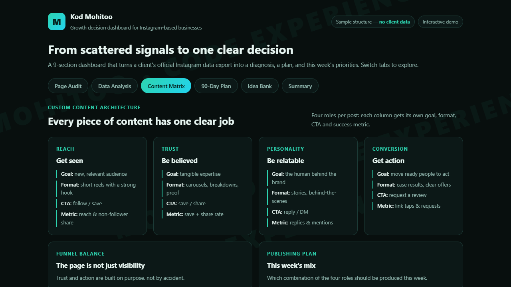
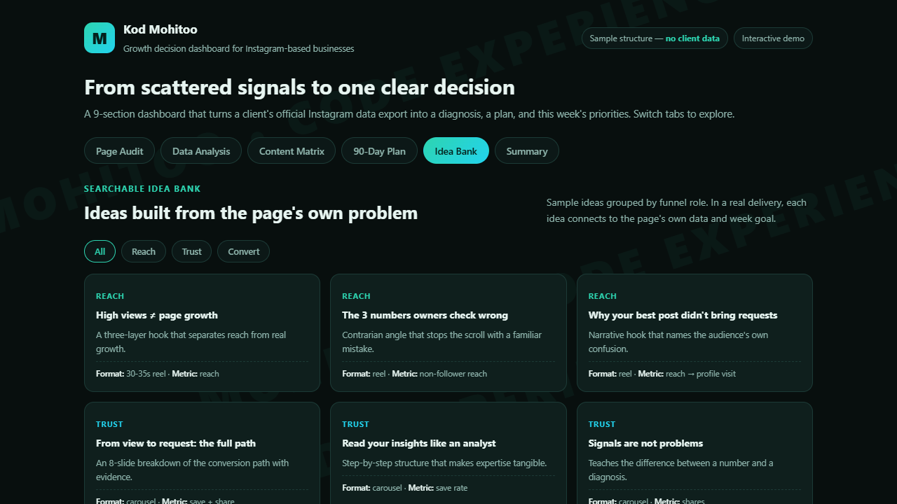

# Mohitoo Growth Dashboard

An interactive, privacy-first growth analytics dashboard for Instagram-based small businesses.
Built by [Amir Pakzad](https://github.com/Amirpaki) — co-founder & product builder at [Mohitoo](https://mohitoocod.ir).

## What it does

Turns a client's official Instagram data export into a structured 9-section decision dashboard:

1. **Page audit** — root-cause diagnosis, account health score, first-fix priority
2. **Data analysis** — reach / engagement / saves patterns, KPI table, win & lose patterns
3. **Market & competitors** — evidence-based positioning, white-space analysis
4. **Content matrix** — four roles per piece of content: reach / trust / personality / conversion
5. **90-day plan** — phased, week-by-week with clear dependencies
6. **Idea bank** — 50 niche-specific content ideas with hook, format, CTA and success metric
7. **Profile packaging** — bio, highlights, pinned posts, action path
8. **Action checklist** — this-week priorities, ordered by impact
9. **Summary** — one clear priority with owner and review metric

## Interactive demo

**[`demo/index.html`](demo/index.html)** — a fully self-contained, interactive English demo of the dashboard: one HTML file, no build step, no external requests, structured sample data (no client data). Download it and open it in any browser — tabs, filters and the idea bank are all live.

### Page Audit — diagnosis before action

### Data Analysis — numbers connect, they don't sit side by side

### Content Matrix — every piece of content has one clear job

### Idea Bank — searchable, grouped by funnel role

## Live product

The production dashboard ships in Persian (RTL) and is live at **https://mohitoocod.ir** — with an interactive Persian demo at https://mohitoocod.ir/demo-dashboard.html. Real-product screenshots are in [`screenshots/live-persian/`](screenshots/live-persian).

## Engineering highlights

- **Privacy-first analytics** — no cookies, no raw IPs, daily-rotated anonymous session keys (HMAC-SHA256), server-side Do-Not-Track respect. DNT users never lose funnel functionality.
- **Server-side integrity** — lead-scoring and request validation are always computed server-side, never trusted from the client; CSRF tokens are stateless HMACs.
- **Zero-build static delivery** — plain HTML/CSS/JS + PHP, no build step, reliable on shared hosting; pages stay lightweight.
- **Persian-first, RTL UX** — dark theme by default, full RTL layout, mobile-tested across common breakpoints.
- **QA-driven** — release gates with Node + PHP test suites and Playwright browser checks before anything ships.

## Tech stack

PHP 8 · MySQL (utf8mb4) · Vanilla JavaScript · HTML/CSS · Playwright (QA)

## Code snippets

Selected, sanitized excerpts in [`snippets/`](snippets/) — the real patterns behind the product's privacy and integrity guarantees, shared with internal details removed.

---

Built by Amir Pakzad. All rights belong to Mohitoo.
